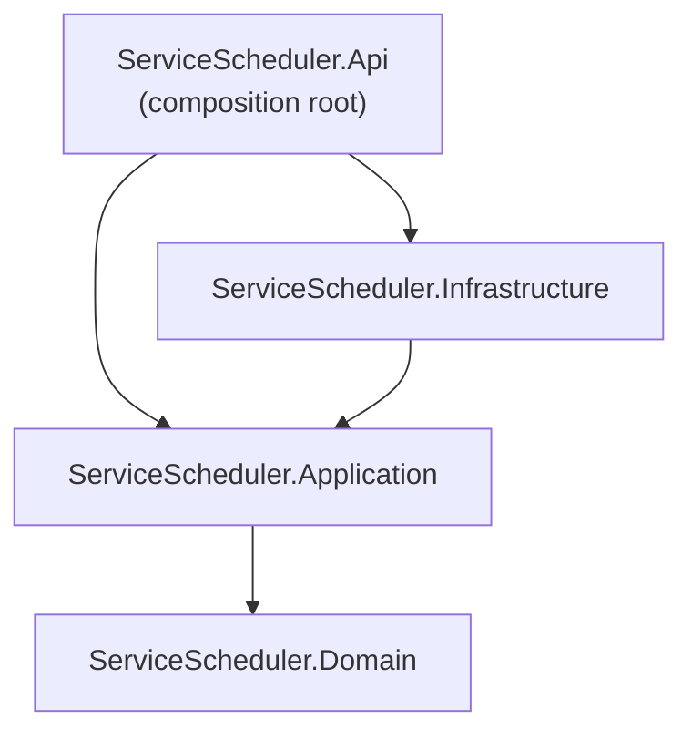

# Architecture

How the code is organised and why. The system-level view is in [SYSTEM_DESIGN.md](SYSTEM_DESIGN.md).

## Solution layout

```text
ServiceScheduler.slnx
src/
  ServiceScheduler.Domain/          Pure C#: no package references
    Appointments/                   Appointment aggregate, SlotReservation, AppointmentErrors
    Catalog/                        ServiceType
    Common/                         Error, ErrorKind, Result<T>
    Customers/                      Customer, Vehicle
    Dealerships/                    Dealership (opening hours, time zone), ServiceBay, Technician
    Scheduling/                     Slots (15-minute grid), TimeRange, ResourceOccupancy
  ServiceScheduler.Application/     Use cases; references Domain + EF Core abstractions
    Abstractions/                   ISchedulerDbContext, IConstraintViolationDetector (ports)
    Appointments/                   BookAppointmentHandler, CancelAppointmentHandler, AppointmentQueries, DTOs
    Availability/                   GetAvailabilityHandler
    Catalog/                        CatalogQueries
    SchedulingErrors.cs             Every expected error code
    SchedulerTelemetry.cs           Meter and ActivitySource
  ServiceScheduler.Infrastructure/  EF Core + SQLite
    Persistence/                    SchedulerDbContext, configurations, migrations, DemoData, DatabaseInitializer
  ServiceScheduler.Api/             ASP.NET Core host and composition root
    Controllers/                    AppointmentsController, DealershipsController, ServiceTypesController
    Contracts/                      BookAppointmentRequest
    Http/                           Problem details mapping, strict timestamp converter, exception handler
    Hosting/                        OpenTelemetry and database start-up
tests/
  ServiceScheduler.UnitTests/       Domain rules, fingerprinting, layer dependencies
  ServiceScheduler.IntegrationTests/ HTTP + real SQLite per test
samples/scheduler.http             Executable API walkthrough
scripts/smoke-test.sh               End-to-end check against a running API (also run in CI)
```

## Dependency rule



Dependencies point inwards. The domain knows nothing about HTTP or storage; the application layer defines the ports
it needs (`ISchedulerDbContext`, `IConstraintViolationDetector`) and the infrastructure implements them. The rule is
enforced twice: by project references (an illegal `using` does not compile) and by `ArchitectureTests`, which inspect
assembly references.

**Pragmatic exception:** the application layer references EF Core's abstractions (`DbSet<T>`, `DbUpdateException`) rather
than hiding them behind repositories. Queries stay explicit and efficient, and the only provider-specific behaviour
(recognising a unique-key violation) sits behind `IConstraintViolationDetector`. See [ADR-0001](adr/0001-layered-architecture.md).

## Request pipeline

Middleware order in `Program.cs`:

1. `UseExceptionHandler` with `UnhandledExceptionHandler` — generic 500 problem, 499 for client disconnects.
2. `UseStatusCodePages` — empty 404/405 responses become problem documents.
3. Development only: OpenAPI document at `/openapi/v1.json`, Swagger UI at `/swagger`, `/` redirects to Swagger.
   Other environments: HSTS and HTTPS redirection.
4. Controllers (`/api/v1/...`) and health checks (`/health/live`, `/health/ready`).

Before `app.Run`, `InitializeDatabaseAsync` applies migrations and seeds demo data when `Database:MigrateOnStartup` and
`Database:SeedDemoData` are true (development and tests only).

## How a request becomes a response

- Controllers translate HTTP into a command or query and call one handler. They contain no rules.
- Handlers return `Result<T>`: a value or an `Error(Kind, Code, Message)`. Expected failures are never exceptions.
- `SchedulerControllerBase.ProblemFor` maps `ErrorKind` to exactly one status (Validation 400, NotFound 404,
  BusinessRule 422, Conflict 409) and writes an RFC 9457 problem with `code` and `traceId`.
- Exceptions are reserved for bugs: the `Appointment` aggregate throws if asked to accept an invalid allocation, which
  the handler should have prevented.

## Dependency injection

| Service | Lifetime | Why |
|---|---|---|
| `SchedulerDbContext` / `ISchedulerDbContext` | Scoped | One unit of work per request |
| Handlers and query classes | Scoped | Depend on the DbContext |
| `SchedulerTelemetry` | Singleton | Owns the meter's instruments |
| `IConstraintViolationDetector` | Singleton | Stateless |
| `TimeProvider` | Singleton | `TimeProvider.System` in production, `FakeTimeProvider` in tests |
| `SchedulingOptions` | Options, validated on start | Booking horizon, allocation attempts |

The connection string is read when each DbContext is created, so tests and environments can override it without
special registration code.

## Where to change things

| To change... | Edit |
|---|---|
| A booking rule or its order | `Application/Appointments/BookAppointmentHandler.cs` |
| An invariant that must never be broken | `Domain/Appointments/Appointment.cs` (`EnsureAllocationIsValid`) |
| Opening-hours or time-zone behaviour | `Domain/Dealerships/Dealership.cs` |
| Error codes or messages | `Application/SchedulingErrors.cs` (codes are part of the public contract) |
| Status code mapping | `Api/Http/ProblemDetailsConventions.cs` |
| Schema | `Infrastructure/Persistence/Configurations/*`, then add a migration ([CONTRIBUTING.md](../CONTRIBUTING.md)) |
| Database provider | `Infrastructure/DependencyInjection.cs` and a new `IConstraintViolationDetector` |
