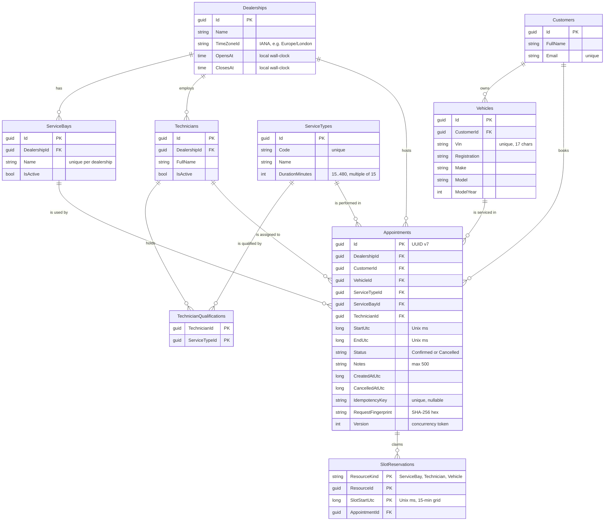
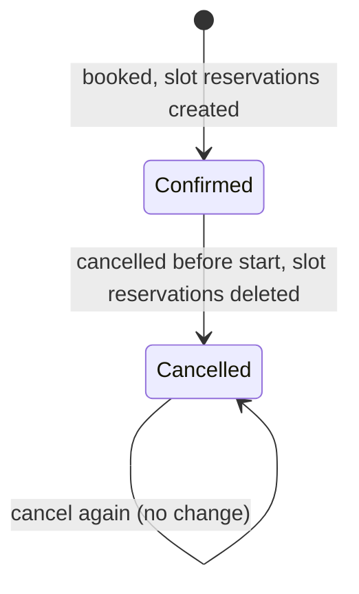

# Data model

Defined by the EF Core configurations in `src/ServiceScheduler.Infrastructure/Persistence/Configurations` and created
by the migration in `Persistence/Migrations`. CI fails if the model and the committed migrations drift apart.

## Entity relationships

## Constraints that protect the rules

| Constraint | Protects |
|---|---|
| `PK_SlotReservations (ResourceKind, ResourceId, SlotStartUtc)` | **No double booking** of a bay, technician or vehicle. One row per resource per 15-minute slot. |
| `IX_Appointments_IdempotencyKey` (unique) | One appointment per idempotency key, even under simultaneous retries. |
| `CK_Appointments_EndAfterStart` | No zero or negative-length appointments. |
| `CK_ServiceTypes_Duration` | Durations are 15-480 minutes in whole slots, so they map onto the grid. |
| `CK_Dealerships_OpeningHours` | Opening time before closing time (no overnight windows). |
| `IX_Vehicles_Vin`, `IX_Customers_Email`, `IX_ServiceTypes_Code`, `IX_ServiceBays_DealershipId_Name` (unique) | Natural-key uniqueness. |
| Foreign keys `ON DELETE RESTRICT` | Reference data in use by appointments cannot be deleted. |
| `SlotReservations.AppointmentId ON DELETE CASCADE` | Reservations never outlive their appointment. |
| `Appointments.Version` concurrency token | Two writers cannot both change the same appointment from the same version. |

## Storage conventions

- **Instants** (`StartUtc`, `EndUtc`, `SlotStartUtc`, `CreatedAtUtc`, `CancelledAtUtc`) are `DateTimeOffset` in UTC in the
  domain and stored as Unix milliseconds (`INTEGER`) through one value converter. SQLite has no timestamp type, and
  numeric storage makes comparisons, ordering and the reservation key exact. Server databases would use native
  `timestamptz`/`datetimeoffset` columns instead.
- **Opening hours** are local wall-clock `TIME` values interpreted in the dealership's IANA time zone.
- **Enums** (`Status`, `ResourceKind`) are stored as strings for readability in the database.
- **Ids** are GUIDs. Appointment ids are UUID version 7 (time-ordered), which keeps index inserts sequential.
- Reference data is created with ids supplied by the caller (`ValueGeneratedNever`), so seed data and tests use stable ids.

## Appointment lifecycle

Cancelled appointments keep their record (who, what, when, `CancelledAtUtc`); only their reservations are removed so the
time can be booked again. Natural future states (`CheckedIn`, `InProgress`, `Completed`, `NoShow`) would extend this enum
and the aggregate's methods.

## Demo data

Seeded on start-up in development and in every integration test (`DemoData.cs`). All data is fictional; emails use
`example.com`.

| Id prefix | Records |
|---|---|
| `de...01` | **Northgate Motors Manchester** — `Europe/London`, 08:00-18:00, Bay 1, Bay 2 (Bay 3 inactive) |
| `de...02` | **Deccan Motors Pune** — `Asia/Kolkata` (UTC+05:30), 09:00-18:00, Bay A |
| `5e...01-06` | Services: Oil and filter change 60 min (`OIL`), MOT test 60 (`MOT`), Full service 120 (`FULL`), Brake pads 90 (`BRAKES`), EV battery health check 30 (`EV_HEALTH`), Tyre fitting 45 (`TYRES`) |
| `7e...` | Manchester: Alice Morgan (OIL, MOT, FULL, BRAKES), Ben Carter (OIL, TYRES, BRAKES), Chloe Davies (EV_HEALTH, OIL, FULL). Pune: Priya Nair (OIL, TYRES, FULL) |
| `c0...` / `ca...` | Sam Taylor (Ford Focus `ca...01`, Nissan Leaf `ca...02`), Emma Wilson (VW Golf `ca...03`, Tesla Model 3 `ca...05`), Arjun Mehta (Hyundai Creta `ca...04`) |

The data is chosen so every rule can be demonstrated: two active bays limit oil changes to two at once, Chloe is the only
EV technician, Alice the only MOT tester, and Pune has nobody qualified for an MOT.
