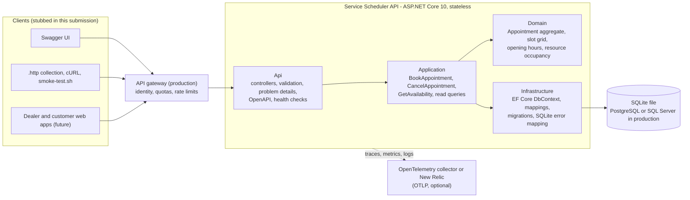
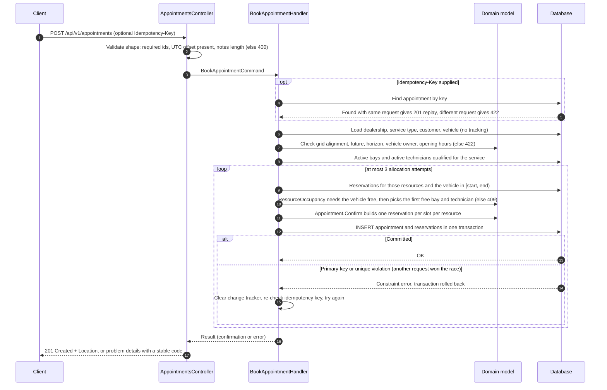

# System Design — Unified Service Scheduler

Keyloop technical assessment, Scenario A (Ownership domain). The backend service is fully implemented; the client layer is
represented by Swagger UI, an executable `.http` collection and a cURL smoke test.

| | |
|---|---|
| Implementation | ASP.NET Core 10 Web API, EF Core 10, SQLite |
| Status | Implemented and verified locally (see [IMPLEMENTATION_STATUS.md](IMPLEMENTATION_STATUS.md)) |
| Detailed references | [Architecture](ARCHITECTURE.md) · [Data model](DATA_MODEL.md) · [API contract](API_CONTRACT.md) · [Decisions](DECISIONS.md) |

---

## 1. Problem statement

Dealership service departments still book work by phone, paper diaries and spreadsheets. Two failures follow:
the same service bay or technician is promised to two customers, and work is assigned to a technician who is
not certified for it. The scheduler replaces manual booking with a service that accepts a request for a
**vehicle, service type, dealership and desired time**, confirms it only if **a service bay and a qualified
technician are both free for the entire service duration**, and stores a **persistent appointment** linking
customer, vehicle, technician and bay.

## 2. Requirements

### Functional

| ID | Requirement | Source |
|---|---|---|
| FR1 | Request an appointment for a vehicle, service type and dealership at a desired time | Brief: resource-constrained booking |
| FR2 | Before confirming, check that a service bay **and** a qualified technician are available for the whole duration | Brief: real-time availability check |
| FR3 | On success, persist an appointment associating customer, vehicle, technician and bay | Brief: confirmed appointment record |
| FR4 | List bookable start times for a service on a day | Supporting FR1/FR2 (clients need to find a free time) |
| FR5 | Read an appointment back | Supporting FR3 |
| FR6 | Cancel an appointment and release its resources | Extension (kept small, fully tested) |
| FR7 | Retrying a booking request must not create a duplicate | Reliability requirement for FR1 |

Traceability from each requirement to code and tests: [REQUIREMENTS.md](REQUIREMENTS.md).

### Non-functional

| Quality | Target in this design |
|---|---|
| Correctness under concurrency | A bay, technician or vehicle can never hold two overlapping confirmed appointments, regardless of how many API instances or simultaneous requests there are. Enforced by the database, not by application locks. |
| Time correctness | No booking depends on the server's time zone; opening hours follow each dealership's local clock, including daylight-saving changes. |
| Reliability | Atomic writes; safe client retries (idempotency keys); clear, stable error codes; health probes. |
| Performance | A booking costs a constant number of indexed queries plus one short write transaction, independent of data volume. |
| Observability | Structured logs, traces and business metrics that never contain customer details. |
| Maintainability | Thin controllers, business rules in the domain, dependencies pointing inwards, every rule covered by tests. |
| Reproducibility | A reviewer can clone, run and test with only the .NET SDK installed. |

## 3. Assumptions and scope

The full list with rationale is in [ASSUMPTIONS.md](ASSUMPTIONS.md). The ones that shape the design:

- **Fixed 15-minute planning grid.** Appointments start on quarter hours; service durations are whole multiples of 15 minutes.
- **A booking occupies three resources**: one service bay, one technician and the vehicle itself (a car cannot be in two places at once).
- **Any active bay can host any service**; technicians need a qualification per service type.
- **One opening window per dealership per day**, in the dealership's IANA time zone; technicians work the dealership's hours.
- **Customers and vehicles already exist** (owned by a CRM/DMS); this service references them and checks the vehicle belongs to the customer.
- **No end-user authentication** is implemented in this submission; production would sit behind an API gateway with identity (see [SECURITY.md](SECURITY.md)).

Out of scope: customer/vehicle/staff management UIs, technician shifts and absences, bay capabilities, pricing,
notifications, rescheduling. Each has a documented extension path in [TRADEOFFS.md](TRADEOFFS.md).

## 4. Architecture



The gateway and telemetry backend are production concerns shown for context; locally, clients call the API directly
and telemetry export is off unless an OTLP endpoint is configured. Code-level structure and the dependency rule are
in [ARCHITECTURE.md](ARCHITECTURE.md).

## 5. Component responsibilities

| Component | Responsibility | Must not |
|---|---|---|
| **Api** (`ServiceScheduler.Api`) | HTTP contract: routing, JSON (strict timestamp parsing), request validation, mapping results to status codes and RFC 9457 problem details, OpenAPI/Swagger, health endpoints, OpenTelemetry wiring, composition root | Contain business rules or query the database |
| **Application** (`ServiceScheduler.Application`) | Use cases: validate business rules in order, load data with efficient queries, allocate resources, run the retry loop, idempotency, metrics and log events; defines the persistence ports it needs | Reference ASP.NET Core or a specific database provider |
| **Domain** (`ServiceScheduler.Domain`) | The model and its invariants: slot grid, time ranges, opening hours in local time, occupancy checks, and the `Appointment` aggregate, which refuses to be created with an invalid allocation and owns its slot reservations | Depend on anything outside the base class library |
| **Infrastructure** (`ServiceScheduler.Infrastructure`) | EF Core mappings, constraints and indexes, migrations, the SQLite unique-violation detector, database initialisation and demo data | Make business decisions |
| **Database** | Durable state and the final arbiter of double-booking through the reservation primary key | — |

## 6. Booking data flow



Reads (availability, appointment by id, catalogue) are single-purpose queries with `AsNoTracking` projections.
Cancellation loads the appointment with its reservations, lets the aggregate change state and clear its
reservations, and saves both in one transaction.

## 7. Database design

Nine tables; the full ER diagram, columns and constraints are in [DATA_MODEL.md](DATA_MODEL.md). The table that
carries the design is:

```text
SlotReservations
  ResourceKind  TEXT     -- ServiceBay | Technician | Vehicle
  ResourceId    TEXT     -- the bay, technician or vehicle id
  SlotStartUtc  INTEGER  -- Unix milliseconds of a 15-minute slot
  AppointmentId TEXT     -- FK -> Appointments, cascade delete
  PRIMARY KEY (ResourceKind, ResourceId, SlotStartUtc)
```

A 60-minute appointment writes 12 rows (4 slots × 3 resources). Other constraints back up the domain rules:
unique idempotency key, unique VIN, service duration a positive multiple of 15 minutes up to 8 hours, opening
before closing, end after start, and restrictive foreign keys everywhere except reservations and qualifications.
`Appointments.Version` is an optimistic concurrency token. Instants are stored as Unix milliseconds because
SQLite has no timestamp type and cannot compare offset-bearing text reliably.

## 8. Availability algorithm

1. **Candidate starts.** For the requested local date, the dealership enumerates every UTC instant on the 15-minute
   grid that could belong to that date (offsets range from −12 to +14 hours) and keeps those whose whole service
   window falls inside opening hours on that local day. Working from instants rather than converting local clock
   times means daylight-saving days need no special case. Starts in the past or beyond the 90-day horizon are dropped.
2. **One occupancy snapshot.** A single indexed query loads all reservations for the dealership's active bays and
   qualified technicians between the first candidate start and the last candidate end.
3. **Counting.** For each candidate, count bays and technicians with no reserved slot in the range. A start is
   offered only if both counts are above zero.

Booking applies exactly the same rules and occupancy check (plus the vehicle) to one candidate, then allocates
**first fit in a stable order** (bays by name, technicians by name). Cost: one reservation query whose size is
bounded by one day; in-memory work is O(candidates × resources × slots per service), a few thousand set lookups.

## 9. Concurrency strategy

The invariant "no resource is booked twice for the same time" is enforced by the **primary key of `SlotReservations`**:

- Every confirmed appointment inserts one row per 15-minute slot for its bay, its technician and its vehicle.
- Overlapping appointments always share at least one slot, so the second insert violates the primary key and the
  whole transaction (appointment row and every reservation) rolls back. Back-to-back appointments share no slot.
- The application still checks occupancy first, so the normal case returns a precise 409 without hitting the constraint.
  When two requests race past that check, the database rejects the loser; the handler clears its unit of work,
  re-reads occupancy and tries the next free resource, up to 3 attempts, then answers 409 `allocation_contention`.
- Because the guard lives in the database, it holds across threads, processes and horizontally scaled API instances.
  Application-level locks were rejected for exactly that reason ([ADR-0003](adr/0003-double-booking-prevention.md)).

Evidence: integration tests fire simultaneous HTTP requests at a real SQLite file and assert exactly as many bookings
as there are free resources; with the conflict handling deliberately disabled, those tests fail every time
([TEST_STRATEGY.md](TEST_STRATEGY.md)).

**SQLite specifics and the path to a server database.** SQLite allows one writer at a time; the API enables WAL mode so
reads continue during writes, and write transactions queue behind a busy timeout. That is ample for one dealership
group on one node but is the first limit to hit. Moving to PostgreSQL or SQL Server keeps the same schema and the same
primary-key guard; only the provider package, the unique-violation detector (`23505` on PostgreSQL, `2627`/`2601` on SQL Server)
and native timestamp columns change. PostgreSQL could alternatively replace slot rows with an exclusion constraint on
`tstzrange` (`EXCLUDE USING gist`), which removes the fixed grid at the cost of provider lock-in.

Cancellation uses the `Version` concurrency token; a concurrent change makes the second writer re-read and re-apply,
so simultaneous cancellations all return 200.

## 10. API design

| Method and path | Purpose | Success |
|---|---|---|
| `GET /api/v1/service-types` | Service catalogue with durations | 200 |
| `GET /api/v1/dealerships` | Dealerships with active bays and technicians' qualifications | 200 |
| `GET /api/v1/dealerships/{id}/availability?serviceTypeId=&date=` | Bookable starts on a local date (default: next day) | 200 |
| `POST /api/v1/appointments` | Book (optional `Idempotency-Key` header) | 201 + `Location` |
| `GET /api/v1/appointments/{id}` | Read an appointment | 200 |
| `POST /api/v1/appointments/{id}/cancel` | Cancel and release slots (idempotent) | 200 |

Errors follow one rule per status: **400** the request is malformed; **404** the resource in the URL does not exist;
**409** the time is not available (bay, technician, vehicle or contention); **422** the request is understood but breaks
a business rule, including ids in the body that do not exist. Every error is an RFC 9457 problem document with a stable
`code` and a `traceId`. Timestamps must carry an explicit UTC offset; responses use the dealership's local offset. The
version is in the path (`/v1`). Full contract, examples and the error-code catalogue: [API_CONTRACT.md](API_CONTRACT.md).

## 11. Technology choices

| Choice | Why |
|---|---|
| .NET 10 (LTS) and ASP.NET Core Web API with controllers | Current long-term support release (supported to November 2028; .NET 8 and 9 reach end of support on 10 November 2026). Controllers match the team's ASP.NET MVC/Web API conventions and give automatic model validation. |
| Entity Framework Core 10 | Migrations, LINQ queries that translate to indexed SQL, change tracking for the aggregate, and provider portability. |
| SQLite | Real relational database with transactions, foreign keys, check constraints and primary keys, zero install for reviewers. Swappable for PostgreSQL/SQL Server ([ADR-0002](adr/0002-technology-and-database.md)). |
| Built-in OpenAPI document + Swagger UI | .NET 10 generates the OpenAPI 3.1 document natively (with XML doc comments); Swagger UI is a static viewer. |
| OpenTelemetry | Vendor-neutral traces, metrics and logs; exports to New Relic or any OTLP backend through configuration only. |
| xUnit v3 on Microsoft Testing Platform, `WebApplicationFactory`, `FakeTimeProvider` | Real HTTP pipeline and real database in tests; a controllable clock instead of mocks. |
| GitHub Actions, Dependabot | Format, build (warnings and vulnerable packages fail it), migration drift, tests, and a live smoke test on every push. |
| No MediatR, AutoMapper or FluentAssertions | Not needed at this size, and each moved to a commercial licence in 2025. Plain handler classes and xUnit assertions keep the dependency surface small. |

## 12. Scalability and performance

- **Stateless API.** Any number of instances can run behind a load balancer once the database is a server database;
  correctness does not depend on instance affinity or in-memory locks.
- **Constant query cost.** A booking issues about eight indexed lookups plus one write transaction; the 201 body is built
  from entities already in memory. Availability is one reservation query per request. No N+1 queries anywhere.
- **Indexes match access paths.** The reservation primary key serves both the conflict check and the occupancy range
  scan (`ResourceKind, ResourceId, SlotStartUtc`); appointments are indexed by idempotency key and by `(DealershipId, StartUtc)`.
- **Bounded growth.** Reservations are only needed for future times. A dealership with 10 bays fully booked writes at most
  10 bays × 40 slots × 3 resources = 1,200 rows a day; past reservations can be archived or deleted without losing the
  appointment record. The 90-day horizon bounds how far ahead rows can exist.
- **Next steps at scale.** PostgreSQL with connection pooling; read replicas for availability; a short-lived availability
  cache invalidated on booking; partitioning reservations by month.

## 13. Reliability and failure handling

- **Atomicity.** Appointment and reservations commit together or not at all (tested by forcing a partial clash).
- **Lost races** are retried automatically with fresh data (up to 3 attempts), then reported as a retryable 409.
- **Client retries** are safe with an `Idempotency-Key`: the same key and body returns the original appointment
  (`Idempotent-Replayed: true`); the same key with a different body returns 422. Even without a key, a duplicate
  submission for the same vehicle and time is rejected by the vehicle rule.
- **Unexpected errors** return a generic 500 problem document (details only in logs); client disconnects are logged
  at debug level and answered with 499 rather than reported as server errors.
- **Health.** `/health/live` (process up) and `/health/ready` (database reachable and no pending migrations) for orchestrators.
- **Configuration is validated at start-up** (booking horizon, retry count), so a bad deployment fails fast.
- **Data.** Production would use a managed database with point-in-time restore; migrations run as a deployment step
  (EF migration bundle), not at application start ([RUNBOOK.md](RUNBOOK.md)).

## 14. Security

Implemented: strict input validation at the boundary and again in the domain, parameterised queries only (EF Core),
16 KB request body limit on booking, problem responses that never include exception details (tested), no server
header, HSTS and HTTPS redirection outside development, Swagger only in development, no customer data in logs,
traces or metrics, no secrets in the repository, vulnerable NuGet packages fail the build, SHA-pinned CI actions with
read-only permissions. **Not implemented and required for production:** authentication, dealership-scoped
authorisation, rate limiting and quotas (gateway), audit trail. Details and threat review: [SECURITY.md](SECURITY.md).

## 15. Observability

- **Logs:** structured, JSON in production, with trace and span ids on every entry; source-generated log methods with
  stable event ids for booked, rejected (with reason code), allocation conflict and cancelled.
- **Traces:** ASP.NET Core server spans plus `BookAppointment` and `CancelAppointment` spans tagged with dealership,
  service type, outcome code and allocation attempts. Health probes are excluded.
- **Metrics:** `scheduler.appointments.booked`, `scheduler.bookings.rejected{reason}`,
  `scheduler.bookings.allocation_conflicts`, `scheduler.bookings.idempotent_replays`, `scheduler.appointments.cancelled`,
  plus the built-in HTTP server metrics.
- **Correlation:** every problem response carries the W3C `traceId`, so a support ticket leads straight to the trace.
- **Export:** OpenTelemetry Protocol to New Relic or any OTLP backend, enabled by setting `OTEL_EXPORTER_OTLP_ENDPOINT`.

Dashboards, alerts and the New Relic set-up: [OBSERVABILITY.md](OBSERVABILITY.md).

## 16. Testing strategy

89 automated tests: 37 unit tests for domain rules (slot grid, daylight saving, half-hour offsets, overlap edges, aggregate
invariants, fingerprinting, layer dependencies) and 52 integration tests that drive the real HTTP pipeline against a fresh
SQLite file per test, with a fake clock. They cover every requirement, every error code, concurrency races, idempotent
retries under load, transaction rollback, cancellation and the generic 500 path. Line coverage of hand-written code is
97.6%. A mutation check proved the concurrency tests detect a disabled conflict handler. A shell smoke test exercises
the running API in CI. Details: [TEST_STRATEGY.md](TEST_STRATEGY.md).

## 17. Trade-offs and future improvements

Main trade-offs: fixed 15-minute grid (simple, database-enforced, but coarse), SQLite (zero set-up, single writer),
first-fit allocation (predictable, not load-balanced), idempotency keys stored on the appointment (atomic, but only
successful requests are remembered and keys never expire). Roadmap: identity and dealership-scoped authorisation,
PostgreSQL, technician shifts and absences, bay capabilities, rescheduling, an outbox for booking events to notify
customers and the DMS. Full list: [TRADEOFFS.md](TRADEOFFS.md).

## 18. How GenAI was used in the design phase

Design was done with GitHub Copilot in agent mode (VS Code), directed by a written execution contract from the developer
that fixed the scenario, layer, stack, quality bar and stop conditions. Within that contract the agent:

- **Decomposed the brief** into the requirement table above and a traceability matrix, separating what the brief requires
  (FR1-FR3) from supporting endpoints and deliberate extensions.
- **Checked facts against live sources instead of model memory**: the .NET release index (which showed .NET 8 and 9 ending
  support on 10 November 2026, so .NET 10 LTS was chosen), NuGet for every package version, xUnit's 4.0 release notes
  (which require Microsoft Testing Platform mode on the .NET 10 SDK), and GitHub for action versions and commit SHAs.
- **Compared alternatives** for double-booking prevention (in-process locks, serialisable transactions, per-slot
  reservation keys, PostgreSQL exclusion constraints) and for time handling, recorded in the ADRs.
- **Reviewed its own design for races before writing code**, which surfaced one: a retried request with an idempotency key
  could have received 409 instead of its original appointment. The design re-checks the key on every conflict path.

The developer's decisions and the agent's proposals are recorded separately, with review status, in
[AI_COLLABORATION.md](AI_COLLABORATION.md) and in each ADR.
